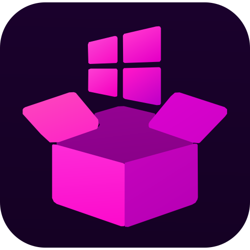

<p align="center">
  
</p>

<h1 align="center">Widwin</h1>

Aplicación de escritorio para Windows que te deja crear **widgets personalizados con HTML, CSS y JS**. Cada widget vive en el escritorio, sin marco, con fondo transparente, y **no se cierra** hasta que tú lo elimines.

## Descargar

| | |
|---|---|
| **Última versión** | [**Descargar Widwin para Windows**](https://github.com/AlejandroBast/Widwin/releases/latest) |
| **Todas las versiones** | [Releases](https://github.com/AlejandroBast/Widwin/releases) |

Descarga el instalador `Widwin-Setup-x.y.z.exe` (recomendado) o la versión sin instalación `Widwin-Portable-x.y.z.exe` desde la última release.
Cada versión nueva se publica automáticamente en Releases con su instalador.

## Características

- Widgets escritos en HTML/CSS/JS, con editor integrado y recarga al guardar (Ctrl+S).
- Plantillas para empezar: en blanco, reloj y notas. También puedes importar un `.html` propio.
- Mover y redimensionar arrastrando, o con coordenadas exactas.
- Opacidad, "siempre encima" e "ignorar clics" por widget.
- Sin botón de cerrar ni minimizar: solo se eliminan desde el gestor. Si uno se cuelga, se recarga solo.
- Se queda en la bandeja del sistema aunque cierres el gestor.
- Inicia con Windows (se puede desactivar) y recuerda la posición de cada widget.
- Cada widget tiene su propio `localStorage`.

## Uso rápido

1. Abre Widwin y pulsa **+ Nuevo**.
2. Elige una plantilla y edita su HTML en el editor.
3. **Guardar y aplicar** (Ctrl+S) para ver el cambio al instante.
4. **Mover / redimensionar** para colocarlo; pulsa **Listo** en el widget al terminar.

Los widgets se guardan en `%APPDATA%\widwin\widgets\<id>\index.html` (botón **Carpeta** en el gestor).

> Nota: no están anclados al escritorio real, así que "Mostrar escritorio" (Win+D) puede ocultarlos. Activa **Siempre encima** en el widget si quieres evitarlo.

## Desarrollo

```bash
npm install
npm start        # ejecutar en modo desarrollo
npm run dist     # generar el instalador en dist/
```

Requiere Node.js 20 o superior.

## Publicar una nueva versión

1. Sube la versión en `package.json` (por ejemplo `1.1.0`).
2. Haz commit y crea la etiqueta:

   ```bash
   git tag v1.1.0
   git push origin main --tags
   ```

3. GitHub Actions compila el instalador y lo publica en [Releases](https://github.com/AlejandroBast/Widwin/releases).
